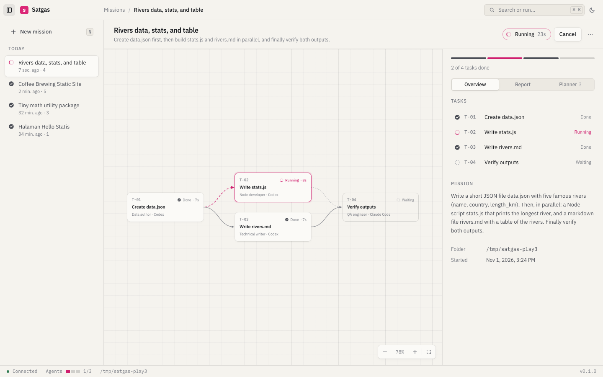

# Satgas

**One mission in. A task force out.**

Satgas is a canvas-based agent development environment. You describe an outcome in plain language;
a planner turns it into a graph of tasks, dispatches each task to a coding agent (Claude Code or Codex),
runs independent work in parallel, and hands every agent the reports of the tasks it depends on.
You watch the whole operation unfold on a live, read-only canvas.



> _Satgas_ is Indonesian for _satuan tugas_, a task force.

## How it works

1. **Brief.** You write the mission and pick a working folder.
2. **Plan.** The planner (Claude, no tools, structured output) splits the mission into a DAG of up to 12 tasks,
   gives each a role, an agent and self-contained instructions, and validates the graph (no cycles, no dangling deps).
3. **Dispatch.** A bounded scheduler (3 agents at a time by default) starts every task whose dependencies are done.
   A failed task skips only its own downstream branch; siblings keep going.
4. **Debrief.** The final task writes the report for you. Every task keeps its live activity log and its own report.

Agents are real CLI processes working in your folder, so the result is real files, not a chat transcript.

## Requirements

- [Bun](https://bun.sh) 1.2 or newer
- [Claude Code](https://docs.claude.com/en/docs/claude-code) installed and signed in (`claude` on your `PATH`), used by the planner and most tasks
- Optional: [Codex CLI](https://github.com/openai/codex) (`codex` on your `PATH`) for tasks the planner assigns to Codex

## Quick start

```sh
git clone https://github.com/zeative/satgas.git
cd satgas
bun install
bun run dev
```

Open <http://localhost:4317>, write a mission, and press <kbd>⌘</kbd>/<kbd>Ctrl</kbd> + <kbd>Enter</kbd>.

To ship a single self-contained binary (server and UI included):

```sh
bun run build      # → dist/satgas
./dist/satgas
```

## Using it

| Key                                            | Action                                           |
| ---------------------------------------------- | ------------------------------------------------ |
| <kbd>⌘K</kbd> / <kbd>Ctrl K</kbd>              | Command palette: every action and every mission  |
| <kbd>N</kbd>                                   | New mission                                      |
| <kbd>⌘\\</kbd> / <kbd>Ctrl \\</kbd>            | Toggle the sidebar                               |
| <kbd>Esc</kbd>                                 | Close the task detail                            |
| Arrows, <kbd>+</kbd> <kbd>−</kbd> <kbd>0</kbd> | Pan, zoom and fit the canvas (when it has focus) |

The UI follows your system theme (a daylight _Chart_ theme and a _Night_ theme) and switches between English and
Bahasa Indonesia based on your browser language.

## Configuration

All settings are environment variables.

| Variable                                 | Default                                             | Purpose                                                                    |
| ---------------------------------------- | --------------------------------------------------- | -------------------------------------------------------------------------- |
| `SATGAS_PORT`                            | `4317`                                              | HTTP port (always bound to `127.0.0.1`)                                    |
| `SATGAS_DATA_DIR`                        | `~/.satgas`                                         | Where missions and logs are stored (`runs/*.json`)                         |
| `SATGAS_DEFAULT_CWD`                     | current directory                                   | Working folder suggested for the first mission                             |
| `SATGAS_CONCURRENCY`                     | `3`                                                 | Agents running at the same time per mission                                |
| `SATGAS_PLANNER_MODEL`                   | `sonnet`                                            | Model used by the planner                                                  |
| `SATGAS_CLAUDE_MODEL`                    | CLI default                                         | Model for Claude Code tasks                                                |
| `SATGAS_CODEX_MODEL`                     | CLI default                                         | Model for Codex tasks                                                      |
| `SATGAS_CLAUDE_PERMISSION_MODE`          | `acceptEdits`                                       | Claude Code permission mode for tasks                                      |
| `SATGAS_CLAUDE_ALLOWED_TOOLS`            | `Read Write Edit Glob Grep Bash WebFetch WebSearch` | Tools Claude Code tasks may use                                            |
| `SATGAS_CODEX_SANDBOX`                   | `workspace-write`                                   | Codex sandbox policy                                                       |
| `SATGAS_LEAN_AGENTS`                     | `1`                                                 | Set to `0` to let agents load your own CLI settings, hooks and MCP servers |
| `SATGAS_CLAUDE_BIN` / `SATGAS_CODEX_BIN` | `claude` / `codex`                                  | Paths to the CLIs                                                          |

**Lean agents.** By default each agent starts without your personal hooks, plugins and MCP servers, so every spawn
starts in a few seconds and stays light. If your CLI depends on settings files (a custom provider, a proxy, a model
set in `settings.json` or `config.toml`), set `SATGAS_LEAN_AGENTS=0`.

## Security model

Satgas runs agents that **read, write and execute commands in the folder you choose**. Treat a mission like running
a script there.

- The server listens on `127.0.0.1` only and refuses cross-origin requests, so a web page you visit cannot start missions.
- Claude Code tasks run with `acceptEdits` and an explicit tool allow-list; Codex tasks run in its `workspace-write` sandbox.
  Both are configurable above.
- Agent output is rendered as text (a small markdown subset built as DOM nodes, never `innerHTML`); only `http(s)` links become links.
- Nothing leaves your machine except what the agent CLIs themselves send to their providers.

## Project layout

```
src/
  server/    Bun HTTP + WebSocket server, planner, scheduler, agent adapters, JSON store
  shared/    Types and graph logic (validation, layout, task codes) used by both sides
  web/       Preact + signals UI, bundled by Bun (no Vite), design tokens in styles.css
tests/       bun test suites, mirroring src/
.interface-design/system.md   The UI design system and its rationale
```

## Development

```sh
bun run dev        # server + UI with hot reload
bun run check      # typecheck, lint (Biome) and tests
bun run format     # apply formatting
```

See [CONTRIBUTING.md](CONTRIBUTING.md) for conventions.

## License

[MIT](LICENSE)
